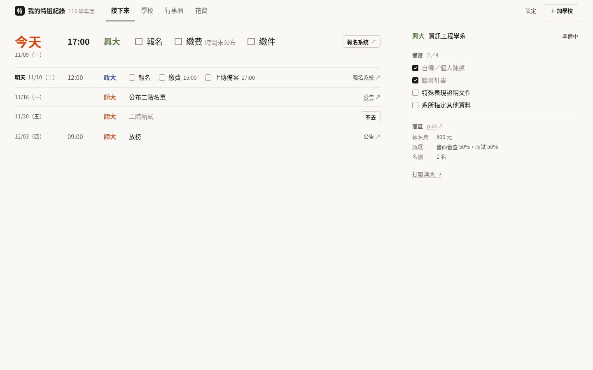

# 我的特選紀錄

給大學**特殊選才**考生用的個人進度網站：投了哪些學校、每個系的報名／繳件／面試／放榜／報到／放棄截止（含時間）、備審清單、面試準備、放榜結果，一個畫面看完。自己架在電腦上，資料全部存本機。



內建 116 學年度 58 校、936 個系組的整理資料與簡章全文，加入一個系之後，日期、備審清單、報名系統連結都會自動帶進來。

## 畫面

| 畫面 | 做什麼 |
| --- | --- |
| **接下來** | 現在要處理的事，一律照日期、時間排：報名要勾的部分（報名・繳費・繳件）、要去的面試、要看的名單和放榜。結果直接在那一列回答（在名單上／正取／備取…），下一件事（報到、遞補）就會出現。右邊是選到那件事的備審清單和簡章重點 |
| **學校** | 左邊一排學校，右邊一間：下一步、時程、備審、紀錄，旁邊是這個階段用得到的簡章重點（附 PDF 頁碼）。平常是純文字，要改哪一段就按那一段的「改」 |
| **行事曆** | 整個月，畫的就是接下來那些事，加上學測等大考日期 |
| **＋ 加學校** | 搜學校、系或簡章裡的任何字（AIS3、APCS、金盾獎…），看報名資格、甄選方式、備審，按「加入」 |

同一天有兩個面試會標「同天」；已經報到一間、又正取另一間時，會先問另一間的放棄辦好了沒有。

## 開始用（三步驟）

1. 安裝 [Node.js](https://nodejs.org/)（18 以上）。
2. 下載這個專案：**Code → Download ZIP** 解壓縮，或 `git clone https://github.com/Zhuyuan0907/Special-Study.git`。
3. 在專案資料夾打開終端機：

```bash
node server.js
# 我的特選紀錄已啟動：http://localhost:5180
```

用瀏覽器開 http://localhost:5180 。第一次會看到三筆範例，在學校頁 ⋯ › 刪除這間學校 清掉，就是你自己的紀錄。不需要 `npm install`，系組資料和簡章全文都已經在 `data/` 裡。

同一個 Wi-Fi 的手機、平板用畫面上印出的「內網」網址就能開。換連接埠或只允許本機：`PORT=3000 node server.js`、`HOST=127.0.0.1 node server.js`。

### 開機自動啟動（Linux）

放在一直開著的 Linux 主機上，用 systemd 讓它開機自己跑、當掉自己重啟。把路徑換成你放專案的位置，存成 `/etc/systemd/system/special-study.service`：

```ini
[Unit]
Description=Special-Study tracker (Node)
After=network-online.target
Wants=network-online.target

[Service]
Type=simple
WorkingDirectory=/root/special-study
ExecStart=/usr/bin/node /root/special-study/server.js
Restart=always
RestartSec=3
Environment=PORT=5180
Environment=HOST=0.0.0.0

[Install]
WantedBy=multi-user.target
```

```bash
sudo systemctl daemon-reload
sudo systemctl enable --now special-study   # 現在啟動，之後開機也會自動啟動
journalctl -u special-study -f              # 看紀錄
```

畫面是照 MacBook 13 吋（1440×900）Chrome 全螢幕設計的，不需要捲動頁面；手機會改成單欄。快速鍵：`1`–`3` 切換畫面、`N` 或 `/` 加學校、`Esc` 取消、`⌘Z` 復原。

## 延伸功能（都在「設定」裡）

- **每日提醒**：每天固定時間把接下來幾天要做的事推到 **Discord**（貼 webhook 網址）或 **Telegram**（bot token）。電腦睡著當天醒來會補送。
- **同步到 Google 試算表**：在試算表的 Apps Script 貼一段程式、部署成網頁應用程式，之後紀錄一變動，所有學校的總表就自動寫進去。不用申請任何 API。
- **行事曆訂閱**：iPhone／Mac 直接訂閱 `webcal://…/api/calendar.ics`（要做的事前一天和三小時前提醒）；Google 日曆用下載的 `.ics` 匯入（Google 的伺服器連不到家裡的電腦，所以不能用網址訂閱）。
- **備份與匯出**：下載 JSON 備份、從備份匯入（會先告訴你會取代幾間）、下載 CSV、複製總表貼到試算表；學校頁 ⋯ › 列印這一間。
- **學測、分科的日期**會一起顯示在行事曆（可關掉）。

## 資料從哪裡來、要注意什麼

- 系組資料與簡章 PDF：[特殊選才網](https://sta-tw.org/bochures/)（日曆小幫手整理），僅供非商業使用。擷取日期寫在設定最下面。
- 報名資格、簡章要求繳交的資料、面試注意事項、格式規定，都是程式從簡章全文**自動節錄**的（灰色小字，旁邊有 p.N 可以開原文那一頁）。它們是起點，不是答案；報名前請對照簡章原文。
- 簡章沒寫時間的截止，畫面寫「時間未公布」，當天結束前都算還沒過。
- 重新抓簡章資料後，伺服器啟動時會把新的日期同步到你的學校：你自己改過的日期不會被蓋掉，改到的會提示一次「簡章更新：…」。
- 簡章 PDF 原檔（約 110 MB）沒有放進專案，所以 p.N 連結預設不會出現；執行下面的更新指令會下載。

## 資料檔

| 檔案 | 內容 | 上傳 Git |
| --- | --- | --- |
| `data/records.json` | 你的紀錄：學校、日期、備審、設定（第一次儲存時建立） | 不要（已在 `.gitignore`） |
| `data/backups/` | 每天第一次存檔前的備份（留 30 天），以及升級、同步、匯入前的備份。`records.json` 壞掉時會自動改用最新的備份 | 不要 |
| `data/records.example.json` | 沒有紀錄時顯示的範例 | 要 |
| `data/overrides.json` | 簡章資料的人工修正（有的話，建資料和伺服器啟動時都會併進來） | 要 |
| `data/programs.json` | 926 個系組的整理資料與對應的簡章頁碼 | 要 |
| `data/brochures/text/*.json` | 57 份簡章逐頁全文 | 要 |
| `data/school-links.json` | 57 校的招生網與網路報名系統網址 | 要 |
| `data/search-terms.json` | 搜尋用的簡稱與同義詞（清大、資工…） | 要 |
| `data/season.json` | 學測、分科等大考日期 | 要 |
| `data/brochures/pdf/*.pdf`、`data/raw/` | 簡章原檔與 API 原始資料 | 不要 |

`records.json` 大致長這樣（`status`：`prep` 準備中、`applied` 已報名、`interview` 待面試、`waiting` 等放榜、`admitted` 正取、`waitlist` 備取、`rejected` 未錄取、`out` 一階未通過、`skipped` 沒有報名；舊的 v2 檔案第一次啟動時會先備份、再自動升級）：

```json
{
  "version": 3,
  "apps": [{
    "id": "…", "v": 3, "rev": 4, "school": "國立清華大學", "dept": "資訊工程學系A組", "programId": "116-002-004",
    "status": "applied", "color": 2, "regNo": "", "place": "", "ivTime": "",
    "dates": [{"id": "…", "kind": "reg", "date": "2026-10-13", "time": "17:00", "from": "2026-09-30", "fromTime": "09:00", "note": "網路報名", "src": "brochure", "ref": "reg|網路報名", "bro": {"date": "2026-10-13", "time": "17:00"}}],
    "docs": [{"id": "…", "name": "自傳", "full": "自傳（1,000 字以內）", "done": false, "src": "brochure"}],
    "regSteps": [{"id": "…", "key": "reg", "name": "報名", "done": true}],
    "hidden": [], "asked": "", "notes": "", "choice": "", "waitNo": null, "confirmDone": false, "giveupDone": false
  }],
  "profile": {"tags": ["apcs"], "notify": {"discord": "…", "time": "08:00", "days": 7}, "sheets": {"url": "…", "auto": true}},
  "syncLog": []
}
```

API（都是 JSON；寫入要帶 `X-Client: 3`，舊版網頁會被擋下來請它重新整理）：`GET /api/records`、`GET /api/meta`、`PUT /api/apps/:id`、`DELETE /api/apps/:id`、`PUT /api/profile`、`PUT /api/todos`、`GET /api/search?q=`、`GET /api/brochure/:code?pages=`、`GET /api/table`（`.csv`）、`GET /api/export.md`、`GET /api/export`、`POST /api/import`（`?dry=1` 只回報）、`GET /api/calendar.ics`、`GET /api/digest`、`POST /api/notify/test`、`POST /api/sheets/sync`。

改程式：日期怎麼算、哪些事要做都在 `public/js/logic.js`（網頁和伺服器共用，改了要重新啟動伺服器）；`npm test` 跑測試。

## 下一個學年度怎麼更新

等特殊選才網放出新學年度的資料後，把 `scripts/build-data.mjs` 裡的 `YEAR` 改掉，執行：

```bash
npm install          # 只為了 pdfjs-dist，抽簡章文字用
npm run build-data   # 下載系組資料與簡章 PDF，重建 data/programs.json 與簡章全文
```

再檢查 `data/school-links.json` 的連結、更新 `data/season.json` 的大考日期。學年度會自動顯示在畫面上。

## 安全提醒

這個伺服器沒有帳號密碼，同一個網路上的人都能看到和修改你的紀錄，也能看到設定裡的 webhook 網址。只在家裡或信任的內網使用，不要把連接埠開到網際網路。

## 授權

程式碼以 [MIT](LICENSE) 授權。簡章內容與系組資料的著作權屬各大學與特殊選才網。
