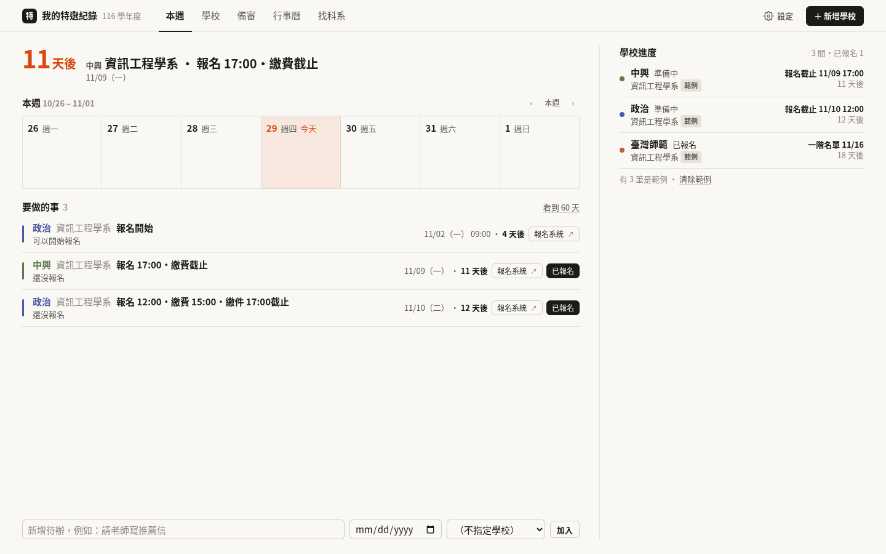

# 我的特選紀錄

給大學**特殊選才**考生用的個人進度網站：投了哪些學校、每個系的報名／繳件／面試／放榜／報到／放棄截止（含時間）、備審清單、面試準備、放榜結果，一個畫面看完。自己架在電腦上，資料全部存本機。



內建 116 學年度 57 校、926 個系組的整理資料與簡章全文，加入一個系之後，日期、備審清單、報名系統連結都會自動帶進來。

## 五個畫面

| 畫面 | 做什麼 |
| --- | --- |
| **本週** | 下一個截止的倒數、這一週七天、要做的事（照日期排，報名系統一鍵前往、按「已報名」就更新狀態）、學校進度 |
| **學校** | 左邊一排學校，右邊照流程分段：報名與日期（報名步驟、准考證號）→ 備審 → 面試（時間、地點、當天要帶、準備重點、面試後紀錄）→ 放榜與結果（正取／備取名次／遞補紀錄／就讀或放棄）→ 簡章重點 |
| **備審** | 所有學校一張表：哪些資料做好了、哪間先截止，勾完直接存 |
| **行事曆** | 整個月，每天直接列出事情，每間學校一個顏色；可以加待辦 |
| **找科系** | 搜科系、學校或簡章裡的任何字（例如 AIS3、APCS、金盾獎），右邊直接看報名資格、甄選方式、要繳的資料和簡章原文；勾選自己的經歷就能列出符合條件的系 |

會自動提醒的事：報名快截止還沒報名、備審沒交齊、面試撞期、報名截止了狀態還是「準備中」、錄取後要在期限內決定、決定讀某一間之後其他學校要辦放棄。

## 開始用（三步驟）

1. 安裝 [Node.js](https://nodejs.org/)（18 以上）。
2. 下載這個專案：**Code → Download ZIP** 解壓縮，或 `git clone https://github.com/Zhuyuan0907/Special-Study.git`。
3. 在專案資料夾打開終端機：

```bash
node server.js
# 我的特選紀錄已啟動：http://localhost:5180
```

用瀏覽器開 http://localhost:5180 。第一次會看到三筆範例，清掉後就是你自己的紀錄。不需要 `npm install`，系組資料和簡章全文都已經在 `data/` 裡。

同一個 Wi-Fi 的手機、平板用畫面上印出的「內網」網址就能開。換連接埠或只允許本機：`PORT=3000 node server.js`、`HOST=127.0.0.1 node server.js`。

### 開機自動啟動（Linux）

放在一直開著的 Linux 主機上，用 systemd 讓它開機自己跑、當掉自己重啟。把路徑換成你放專案的位置，存成 `/etc/systemd/system/special-study.service`：

```ini
[Unit]
Description=Special-Study tracker (Node)
After=network-online.target
Wants=network-online.target

[Service]
Type=simple
WorkingDirectory=/root/special-study
ExecStart=/usr/bin/node /root/special-study/server.js
Restart=always
RestartSec=3
Environment=PORT=5180
Environment=HOST=0.0.0.0

[Install]
WantedBy=multi-user.target
```

```bash
sudo systemctl daemon-reload
sudo systemctl enable --now special-study   # 現在啟動，之後開機也會自動啟動
journalctl -u special-study -f              # 看紀錄
```

畫面是照 MacBook 13 吋（1440×900）Chrome 全螢幕設計的，不需要捲動頁面；手機會改成單欄。快速鍵：`1`–`5` 切換畫面、`N` 新增學校、`/` 搜尋科系。

## 延伸功能（都在「設定」裡）

- **每日提醒**：每天固定時間把接下來幾天的日期和待辦推到 **Discord**（貼 webhook 網址）或 **Telegram**（bot token）。電腦睡著當天醒來會補送。
- **同步到 Google 試算表**：在試算表的 Apps Script 貼一段程式、部署成網頁應用程式，之後紀錄一變動，所有學校的總表就自動寫進去。不用申請任何 API。
- **行事曆**：iPhone／Mac 直接訂閱 `webcal://…/api/calendar.ics`（截止前一天和三小時前提醒）；Google 日曆用下載的 `.ics` 或 CSV 匯入（Google 的伺服器連不到家裡的電腦，所以不能用網址訂閱）。每個日期也有「加到 Google 日曆」。
- **匯出**：一鍵複製總表貼到試算表、下載 CSV、Markdown（Notion、HackMD）、JSON 備份與還原、列印一頁總表或單一學校（含當天要帶的清單）。
- **學測、分科的日期**會一起顯示在本週和行事曆（可關掉）。

## 資料從哪裡來、要注意什麼

- 系組資料與簡章 PDF：[特殊選才網](https://sta-tw.org/bochures/)（日曆小幫手整理），僅供非商業使用。`data/programs.json` 的擷取日期會顯示在設定的「特選須知」。
- 報名資格、簡章要求繳交的資料、面試注意事項、格式規定，都是程式從簡章全文**自動節錄**的，畫面上有標示。它們是起點，不是答案；報名前請對照簡章原文（每個系都附原文頁面）。
- 來源資料裡部分截止時間是「00:00」，實際可能是 18:00 或 24:00，這種會顯示「時間請看簡章」。
- 簡章 PDF 原檔（約 110 MB）沒有放進專案，所以「簡章 PDF」連結預設不會出現；執行下面的更新指令會下載。

## 資料檔

| 檔案 | 內容 | 上傳 Git |
| --- | --- | --- |
| `data/records.json` | 你的紀錄：學校、日期、備審、待辦、設定（第一次儲存時建立） | 不要（已在 `.gitignore`） |
| `data/records.example.json` | 沒有紀錄時顯示的範例 | 要 |
| `data/programs.json` | 926 個系組的整理資料與對應的簡章頁碼 | 要 |
| `data/brochures/text/*.json` | 57 份簡章逐頁全文 | 要 |
| `data/school-links.json` | 57 校的招生網與網路報名系統網址 | 要 |
| `data/search-terms.json` | 搜尋用的簡稱與同義詞（清大、資工…） | 要 |
| `data/season.json` | 學測、分科等大考日期 | 要 |
| `data/brochures/pdf/*.pdf`、`data/raw/` | 簡章原檔與 API 原始資料 | 不要 |

`records.json` 大致長這樣（`status`：`prep` 準備中、`applied` 已報名、`interview` 通過一階、`waiting` 已面試、`admitted` 正取、`waitlist` 備取、`rejected` 未錄取、`out` 一階未通過、`skipped` 沒有報名）：

```json
{
  "version": 2,
  "apps": [{
    "id": "…", "school": "國立清華大學", "dept": "資訊工程學系A組", "programId": "116-002-004",
    "status": "applied", "color": 2, "regNo": "", "place": "",
    "dates": [{"id": "…", "kind": "reg", "date": "2026-10-13", "end": "", "time": "17:00", "note": "網路報名"}],
    "docs": [{"id": "…", "name": "自傳", "done": false}],
    "regSteps": [{"id": "…", "name": "網路報名完成", "done": true}],
    "kit": [{"id": "…", "name": "身分證", "done": false}],
    "waitLog": [], "prep": "", "asked": "", "notes": "", "choice": "", "waitNo": null
  }],
  "todos": [{"id": "…", "text": "請老師寫推薦信", "due": "2026-11-05", "appId": "", "done": false}],
  "profile": {"tags": ["apcs"], "notify": {"discord": "…", "time": "08:00", "days": 7}, "sheets": {"url": "…", "auto": true}}
}
```

API（都是 JSON）：`GET /api/records`、`PUT /api/apps/:id`、`DELETE /api/apps/:id`、`PUT /api/todos`、`PUT /api/profile`、`GET /api/search?q=`、`GET /api/brochure/:code?pages=`、`GET /api/table`（`.csv`）、`GET /api/export.md`、`GET /api/export`、`POST /api/import`、`GET /api/calendar.ics`、`GET /api/digest`、`POST /api/notify/test`、`POST /api/sheets/sync`。

## 下一個學年度怎麼更新

等特殊選才網放出新學年度的資料後，把 `scripts/build-data.mjs` 裡的 `YEAR` 改掉，執行：

```bash
npm install          # 只為了 pdfjs-dist，抽簡章文字用
npm run build-data   # 下載系組資料與簡章 PDF，重建 data/programs.json 與簡章全文
```

再檢查 `data/school-links.json` 的連結、更新 `data/season.json` 的大考日期。學年度會自動顯示在畫面上。

## 安全提醒

這個伺服器沒有帳號密碼，同一個網路上的人都能看到和修改你的紀錄，也能看到設定裡的 webhook 網址。只在家裡或信任的內網使用，不要把連接埠開到網際網路。

## 授權

程式碼以 [MIT](LICENSE) 授權。簡章內容與系組資料的著作權屬各大學與特殊選才網。
